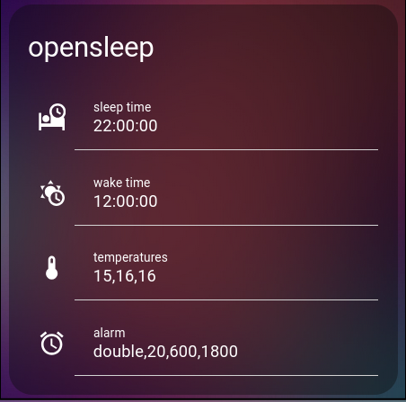

# opensleep

Open-source Rust firmware for the Eight Sleep Pod 3 that completely replaces Eight Sleep's proprietary software stack.

## Disclaimer

This project is for educational and research purposes only. It is for personal, non-commercial use and is not affiliated with, endorsed by, or sponsored by Eight Sleep. The Eight Sleep name and Pod are trademarks of Eight Sleep, Inc.

Using opensleep will prevent the Eight Sleep mobile app from working and may (though unlikely) permanently alter or damage your device. **Use at your own risk.**

## What is Eight Sleep?

The Eight Sleep Pod 3 is a smart mattress cover that uses water circulation to control temperature (55°F to 110°F) and tracks sleep metrics. While powerful, Eight Sleep's default firmware streams all sleep data to their servers, including when you're in bed, how many people are in bed, and your sleep patterns.

## Why Replace the Firmware?

1. **Complete Privacy**: All data stays local.
2. **Smart Home Integration**: Direct control through Home Assistant, MQTT, or custom automations instead of being locked to Eight Sleep's app.
3. **Enhanced Features**: Custom temperature profiles, alarms, etc.

## Features

1. **MQTT** interface for remote configuration and state monitoring
2. Configuration via **[Ron](https://github.com/ron-rs/ron)** file
3. Presence detection
4. Custom temperature profiles with unlimited points, automatically distributed between `sleep` and `wake` times
5. Vibration alarms relative to `wake` time (offsets and vibration settings are configurable)
6. `Solo` or `Couples` modes
7. LED control with custom effects
8. Daily priming

## How This Differs from Other Projects

Other projects like [ninesleep](https://github.com/bobobo1618/ninesleep) and [freesleep](https://github.com/throwaway31265/free-sleep) work by replacing the Device-API-Client (DAC).
By replacing the DAC, they can communicate directly with frankenfirmware and send temperature commands,
receive sleep tracking data, set alarms, etc.

**opensleep replaces all Eight Sleep programs**, communicating directly with the microcontrollers that manage sensors and temperature control. This enables real-time sensor data access and complete control over the Pod's behavior.



## Technical Overview

The Eight Sleep Pod 3 consists of:

- **SOM** (System-On-Module): A Variscite i.MX 8M Mini running Yocto Linux, acting as the master controller
- **Sensor Subsystem**: STM32 microcontroller managing temperature sensors, capacitance sensors (for presence), piezoelectric sensors, and vibration motors
- **Frozen Subsystem**: STM32 microcontroller managing thermoelectric coolers, water pumps, and priming components

Eight Sleep's stock firmware runs three main programs on the SOM:
- **DAC** (Device-API-Client): Communicates with Eight Sleep's servers
- **Frank** (frankenfirmware): Controls both subsystems via USART
- **Capybara**: Manages LEDs and Bluetooth setup

opensleep replaces all three programs, communicating directly with the Sensor and Frozen subsystems via their USART protocols.

For detailed technical information, see [BACKGROUND.md](BACKGROUND.md).

## Setup

Setting up opensleep requires SSH access to the Pod's SOM, which involves hardware modification. This is **not trivial** and requires technical expertise. Some Pod variants require specialized tools.

**Compatibility:**
- ✅ **Pod 3**: Fully supported (the only version tested with opensleep)
- ⚠️ **Pod 4/5**: Untested. SSH setup possible but Pod-specific features not implemented. If you'd like to help add support, please contact me.
- ❌ **Pod 1/2**: Not possible

See detailed setup instructions in [SETUP.md](SETUP.md).

## MQTT Integration

opensleep exposes full control and monitoring through MQTT. You can:
- Monitor presence, temperature, and sensor data in real-time
- Adjust temperature profiles, alarms, and settings
- Trigger actions like calibration (for presence detection)

See the complete MQTT specification in [MQTT.md](MQTT.md).

## Home Assistant

opensleep integrates cleanly with Home Assistant via MQTT. You can build custom dashboards and automations.

See Home Assistant configuration examples in [HASS.md](HASS.md).



## Roadmap

- [ ] Use Sensor subsystem bed temperature readings to improve Frozen temperature control
- [ ] Sleep Tracking: Heart rate, HRV, and breathing rate analysis
- [ ] Advanced LED patterns using direct current level control

## Development

Run in debug mode:
```bash
RUST_LOG=debug,rumqttc=info ./opensleep
```

(This prevents rumqttc from spamming logs)

## Contact

If you encounter issues, please open an issue on this repository. For other inquiries, contact me at [mail@liamsnow.com](mailto:mail@liamsnow.com).

